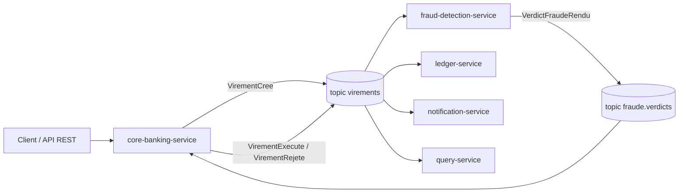

# BamcBank — banque événementielle avec Kafka

> Projet portfolio en cours de construction · Phase 1 / 7 : **Fondations**

BamcBank simule le cœur d'un service de **virements bancaires internes**, conçu comme on le ferait en production :

- **Architecture hexagonale** : le domaine métier ne dépend d'aucun framework (Spring, JPA, Kafka), et c'est vérifié automatiquement par des tests ArchUnit.
- **Event-driven avec Kafka** : les services communiquent par événements, avec les garanties qui vont avec (outbox transactionnelle, idempotence, dead letter topic, ordre par compte).
- **CQRS léger** : une base de lecture séparée, alimentée par les événements.
- **Traitement de flux** : détection de fraude en temps réel avec Kafka Streams (fenêtres de temps par compte).
- **TDD et DDD tactique** : chaque règle métier commence par un test.

## Le parcours d'un virement

1. Le client demande un virement : les fonds sont **réservés** et le virement passe en `EN_ATTENTE_FRAUDE`.
2. Le service de fraude analyse le virement et rend un **verdict**.
3. Le virement est **exécuté** (le compte débité, le destinataire crédité) ou **rejeté** (les fonds sont libérés).
4. Le grand livre comptable, les notifications et la vue de lecture réagissent au résultat.



## Services

| Service           | Rôle                                                                   | Statut      |
| ----------------- | ---------------------------------------------------------------------- | ----------- |
| `corebanking`     | Propriétaire du solde : réservation, exécution ou libération des fonds | 🚧 En cours |
| `fraud-detection` | Verdict de fraude en streaming (Kafka Streams)                         | ⏳ Phase 3  |
| `ledger`          | Grand livre comptable en partie double                                 | ⏳ Phase 3  |
| `query`           | Vue de lecture (CQRS)                                                  | ⏳ Phase 4  |
| `notification`    | Notifications client                                                   | ⏳ Phase 4  |
| `gateway`         | Authentification, routage                                              | ⏳ Phase 6  |

## Stack

Java 21 · Spring Boot 4 · Maven · Kafka (KRaft) + Schema Registry (Avro) · Debezium · PostgreSQL · Kafka Streams · JUnit 5 · Testcontainers · ArchUnit · OpenTelemetry · Prometheus · Grafana · Docker Compose · GitHub Actions

## Roadmap

- [ ] **Phase 1 — Fondations** : domaine du virement en hexagonal pur, testé sans Spring
- [ ] **Phase 2 — Outbox + CDC** : API REST documentée, PostgreSQL, outbox transactionnelle et Debezium
- [ ] **Phase 3 — Fraude + Ledger** : Kafka Streams, idempotence, dead letter topic
- [ ] **Phase 4 — CQRS + notifications**
- [ ] **Phase 5 — Observabilité** : une trace unique suit un virement à travers tous les services
- [ ] **Phase 6 — Auth**
- [ ] **Phase 7 — Déploiement** : CI/CD complet et démo hébergée

## Lancer le projet

Prérequis : Java 21.

```bash
cd corebanking
./mvnw test          # Linux / macOS
mvnw.cmd test        # Windows
```

## Conventions

- **Branches** : `<type>/<n°-issue>-<description>`, par exemple `feat/6-montant-value-object`.
- **Commits** : [Conventional Commits](https://www.conventionalcommits.org/fr/), par exemple `feat(domain): refuse un montant négatif`.
- **Une branche = une issue = une PR**, mergée seulement si la CI est verte.
- Les décisions d'architecture sont documentées dans des **ADR** (à venir dans `docs/adr/`).

## Outillage IA

Le développement est assisté par Claude : les règles du projet sont versionnées dans `CLAUDE.md` (le domaine n'importe jamais de framework, TDD obligatoire…). L'IA propose, je décide : ses modifications passent par des PR, avec relecture humaine et CI verte avant tout merge, et elle ne merge jamais seule.
